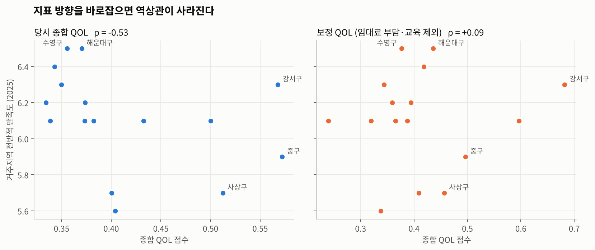
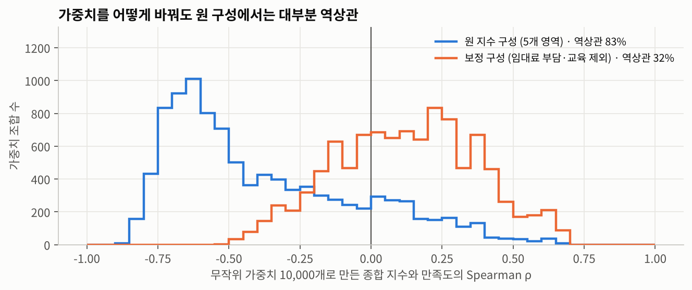
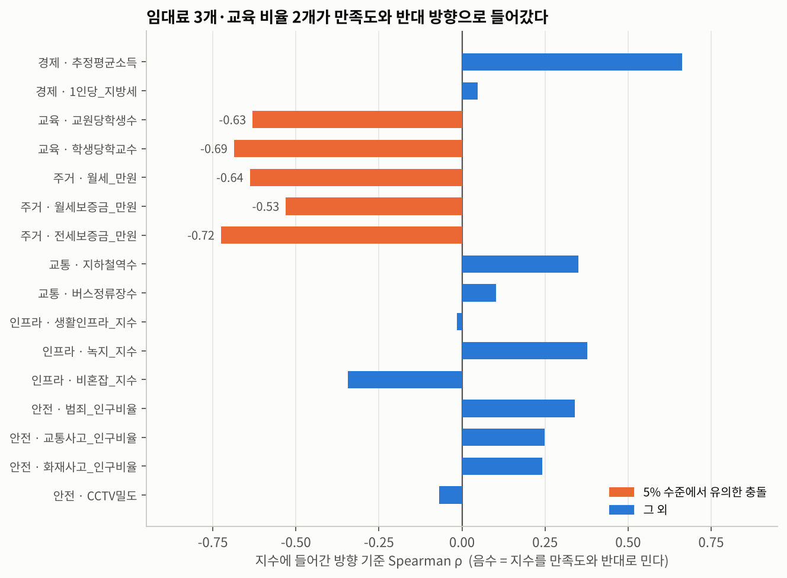
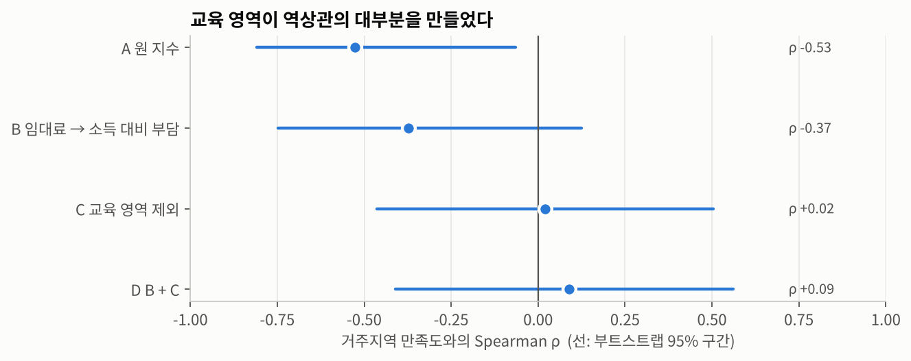

# 부산 구·군별 삶의 질(QOL) 지수 재분석: '역설'인가, 지표 설계의 결과인가

> 5인 팀 프로젝트 · SK플래닛 관광 MICE 빅데이터 전문가 과정 (2025.12.23 – 2026.01.01) · 2026.10 개인 재분석 · Python

부산 16개 구·군의 5개 영역 지표로 삶의 질(QOL) 지수를 만들고, 주민 만족도와 비교했습니다. 지수가 높은 구일수록 만족도가 낮게 나왔고, 당시 팀은 이를 **'성장의 역설(이스털린 역설)'** 로 해석했습니다.

재분석에서는 해석보다 지표를 먼저 의심했습니다. 그 결과 **임대료 3개, 교육 비율 2개 지표가 만족도와 반대 방향으로 들어가 있었고**, 이 두 가지를 바로잡자 역상관이 사라졌습니다(ρ −0.53 → +0.09). 역상관은 역설이 아니라 지표 설계에서 나왔을 가능성이 큽니다.

<p align="center"></p>

## 데이터

| 항목 | 내용 |
|---|---|
| 단위 | 부산 16개 구·군 |
| 지수 | 5개 영역 16개 지표 (교육·경제·주거교통·인프라·안전), 팀 산출 |
| 만족도 | 부산광역시 「2025 부산사회조사」 구·군별 '거주지역의 전반적 만족도' |
| 파일 | `data/indicators_raw.csv` (지표 원값), `data/qol_team_v1_20251229.csv` (당시 영역 점수), `data/satisfaction_2025.csv` |

자세한 출처와 변수 정의는 [`data/README.md`](data/README.md)에 정리했습니다.

## 당시 분석 (2025.12)

영역별로 지표를 MinMax 정규화해 평균 내고, 5개 영역을 가중합했습니다(경제·주거교통 0.25, 인프라 0.20, 교육·안전 0.15). 저는 **주거·교통 지수 산출**과 **통합 회귀·상관분석**을 맡았습니다.

| 분석 | 결과 |
|---|---|
| 다중회귀: 만족도 ~ 5개 영역 | R² 0.609 · 수정 R² 0.413 · F검정 p 0.0595 |
| 유의한 계수 | 주거교통 −1.07 (p 0.046) |
| 종합 QOL vs 만족도 | 가중합 Pearson r −0.35 · 등가중 −0.48 · 순위상관 ρ −0.53 (p 0.037) |

- **당시 해석:** 객관적 조건이 좋은 곳일수록 만족도가 낮다(이스털린 역설). 교통이 편한 곳은 혼잡과 스트레스가 커서 만족도가 낮다.
- **당시 놓친 점**
  1. 가중치를 곱한 변수로 다시 회귀했지만, 변수에 상수를 곱해도 적합도는 같습니다(R² 0.609 그대로). 회귀로는 가중치를 검증할 수 없었습니다.
  2. 표본 16개에 변수 5개라 모형 전체가 5% 수준에서 유의하지 않았습니다.
  3. 지수가 만족도와 반대로 움직였을 때, 해석에 앞서 지표의 방향을 점검하지 않았습니다.

## 재분석 (2026.10)

### 1. 음수 계수는 교통이 아니라 임대료에서 나왔습니다

주거교통 지수를 원래 산식 그대로 다시 계산해(팀 산출값과 차이 0) 주거와 교통 부분으로 나눴습니다.

| 부분 | 만족도와 순위상관 ρ |
|---|---|
| 주거교통 전체 | −0.39 (p 0.136) |
| 주거 (임대료가 낮을수록 높은 점수) | **−0.77 (p 0.001)** |
| 교통 (역·정류장 수) | +0.33 (p 0.206) |

교통 부분은 오히려 만족도와 같은 방향입니다. "교통이 편한 곳은 스트레스가 크다"는 당시 해석은 데이터가 뒷받침하지 않습니다.

### 2. 가중치 문제가 아닙니다

5개 영역 가중치를 무작위로 10,000번 바꿔 종합 지수를 다시 만들었습니다. **83%의 조합에서 역상관**이 나왔습니다. 문제는 가중치가 아니라 지수에 들어간 재료에 있습니다.

<p align="center"></p>

### 3. 만족도와 반대 방향으로 들어간 지표 5개

각 지표를 지수에 들어간 방향 그대로 놓고 만족도와의 순위상관을 봤습니다. 음수면 그 지표가 지수를 만족도와 반대로 밀어냅니다.

<p align="center"></p>

충돌한 지표는 **임대료 3개와 교육 비율 2개**였습니다. 같은 데이터로 원인을 정하면 순환논리가 되므로, 원인은 **만족도를 쓰지 않고** 다른 변수로 확인했습니다.

| 지표 | 지수에 넣은 방향 | 만족도를 쓰지 않은 확인 | 해석 |
|---|---|---|---|
| 월세·월세보증금·전세보증금 | 낮을수록 좋음 | 임대료가 높은 곳은 소득(월세보증금 ρ +0.67)과 안전 지수(+0.60)도 높음 | 임대료는 '부담'이면서 동네의 선호도가 가격에 반영된 값입니다. 싸다고 좋은 곳이 아닙니다. |
| 교원당 학생 수 | 낮을수록 좋음 | 학생 수와 ρ +0.66 | 학생이 줄어든 원도심이 좋은 점수를 받습니다(중구 학생 2,680명). |
| 학생당 학교 수 | 높을수록 좋음 | 학생 수와 ρ −0.68 | 교육 여건보다 인구 감소를 재고 있었습니다. |

### 4. 한 번에 하나씩 바로잡기

원인이 섞이지 않도록 보정을 하나씩 적용했습니다.

- **B:** 임대료 '수준'을 '소득 대비 부담'으로 바꿈 (월세 ÷ 월소득, 보증금 ÷ 연소득). 가중치와 방향은 그대로.
- **C:** 교육 영역 제외. 학생 규모와 무관한 대체 지표가 없어 빼고 나머지 가중치를 비례 조정.
- **D:** B와 C를 함께 적용.

| 지수 | ρ | p | 한 구씩 빼고 다시 계산 | 부트스트랩 95% 구간 |
|---|---|---|---|---|
| A 원 지수 | **−0.53** | 0.037 | −0.68 ~ −0.47 | −0.81 ~ −0.06 |
| B 임대료 → 소득 대비 부담 | −0.37 | 0.155 | −0.54 ~ −0.31 | −0.75 ~ +0.12 |
| C 교육 영역 제외 | +0.02 | 0.939 | −0.11 ~ +0.13 | −0.46 ~ +0.50 |
| D B + C | **+0.09** | 0.741 | −0.07 ~ +0.21 | −0.41 ~ +0.56 |

<p align="center"></p>

교육 영역 하나를 빼자 역상관이 사라졌습니다(−0.53 → +0.02). 원 지수의 역상관은 어떤 구 하나를 빼도 유지됐지만, 보정 지수는 0 근처에 머뭅니다.

## 결론

1. **결론이 바뀌었습니다.** "객관적 QOL과 만족도는 반대로 움직인다"에서 "지표 방향을 바로잡으면 관계가 사라진다"로 바뀌었습니다. 역상관은 지표 설계의 결과일 가능성이 큽니다.
2. **보정 지수가 만족도를 설명하는 것도 아닙니다.** ρ +0.09에 95% 구간이 −0.41 ~ +0.56입니다. 이 데이터로는 비례한다고도, 반비례한다고도 말할 수 없습니다.
3. **이스털린 역설을 적용할 근거도 약합니다.** 이 개념은 소득이 늘어도 행복이 따라 오르지 않는 시간적 현상을 다룹니다. 16개 구의 한 시점 비교와는 다른 문제입니다. 실제로 소득 지표만 보면 만족도와 같은 방향입니다(ρ +0.66).
4. **배운 점:** 지수가 결과 변수와 반대로 나오면, 해석하기 전에 지표의 방향부터 검증합니다. 그 검증은 결과 변수가 아닌 다른 변수로 합니다.

## 한계와 다음 단계

- 표본이 16개 구·군이고 지표 16개를 동시에 검정했습니다. 개별 p값은 참고용입니다.
- 보정은 만족도 결과를 본 뒤 설계했습니다. 원인을 만족도가 아닌 변수로 먼저 확인했지만, 보정 지수가 '맞는' 지수라는 근거는 아닙니다. 다른 연도 만족도로 검증해야 합니다.
- 교육 영역은 대체 지표 없이 뺐습니다. 학령인구 대비 지표처럼 규모의 영향을 걷어낸 지표가 필요합니다.
- 중구는 보정 후에도 지수 3위(만족도 13위)입니다. 주민등록 인구를 분모로 쓰는 1인당 지표가 유동인구가 많은 중구를 과대평가하는 문제가 남아 있습니다. 팀의 안전 분석에서도 같은 구조를 지적했습니다.
- 만족도는 단일 조사의 구별 평균입니다.

## 실행 방법

```bash
pip install -r requirements.txt
python analysis/01_original_analysis.py   # 당시 분석 재현
python analysis/02_reanalysis.py          # 재분석, results/ 와 figures/ 생성
```

## 구조

```text
.
├── data/
│   ├── indicators_raw.csv          # 16개 구·군 × 지표 원값
│   ├── qol_team_v1_20251229.csv    # 당시 회귀에 쓴 영역별 QOL
│   ├── qol_team_final.csv          # 교육 지표 수정 최종본 (참고)
│   ├── satisfaction_2025.csv       # 2025 부산사회조사 만족도
│   └── README.md                   # 출처와 변수 정의
├── analysis/
│   ├── common.py                   # 정규화·지수 산식
│   ├── 01_original_analysis.py
│   └── 02_reanalysis.py
├── results/                        # 스크립트 출력 (표·로그)
└── figures/
```

## 역할

- **팀 프로젝트 (2025.12):** 교육·경제·인프라·안전 지수는 팀원이 산출했습니다. 저는 주거·교통 지수(전월세 이상치 처리, 교통 접근성 지표)와 5개 영역 통합 회귀·상관분석을 맡았습니다.
- **재분석 (2026.10):** 개인 작업입니다. 팀 저장소의 산출 데이터를 그대로 사용했습니다.

## 기술 스택

Python · pandas · NumPy · SciPy · statsmodels · Matplotlib
